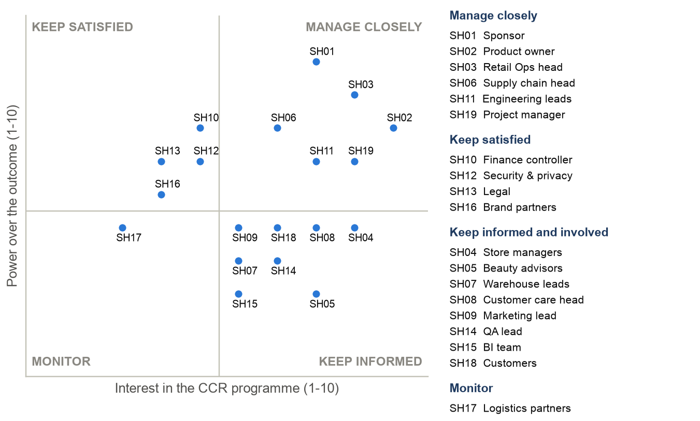
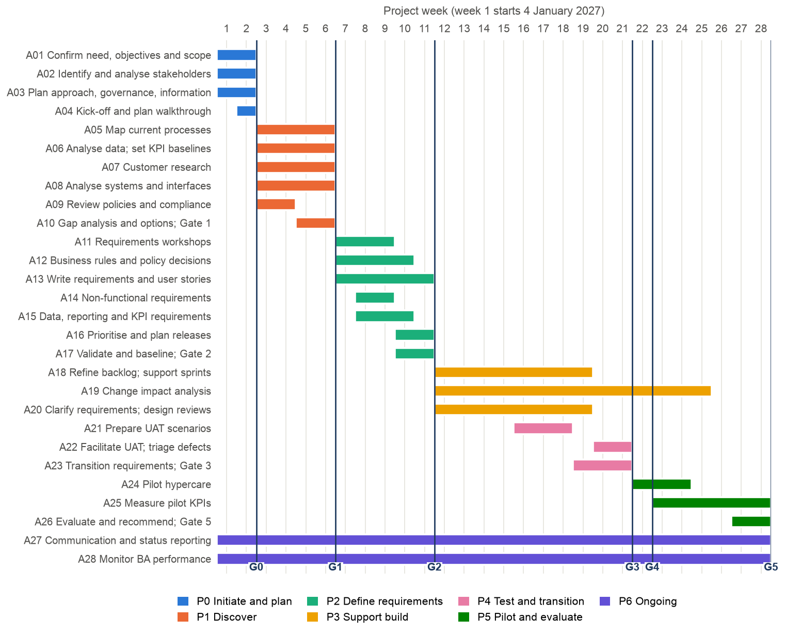
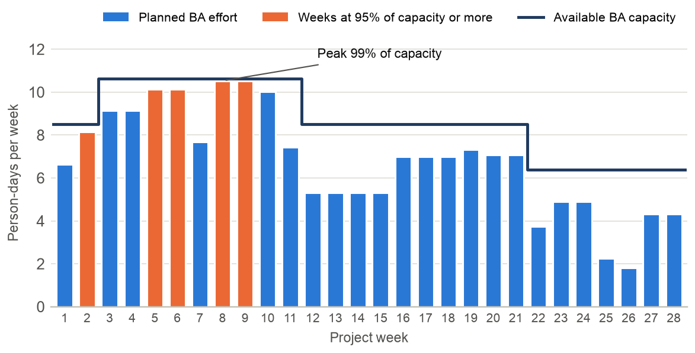
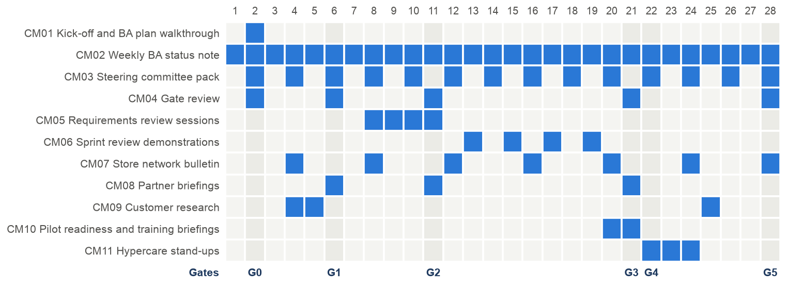

# Business Analyst Internship - Week 1

## Business Analysis Plan: Nykaa Click, Collect & Return Programme

Week 1 of the Business Analyst Internship. This repository holds the working files behind a business
analysis plan for a proposed omnichannel programme at Nykaa (FSN E-Commerce Ventures Limited): click &
collect, return to store and assisted ordering for Nykaa Beauty, piloted in 20 Nykaa stores in two metro cities.

| Week | Repository |
|---|---|
| **1** | **Business analysis plan (this repository)** |
| 2 | [Business-Analyst-Internship-Week-2](https://github.com/Pharos-0/Business-Analyst-Internship-Week-2): elicitation and collaboration |
| 3 | [Business-Analyst-Internship-Week-3](https://github.com/Pharos-0/Business-Analyst-Internship-Week-3): requirements life cycle management |
| 4 | [Business-Analyst-Internship-Week-4](https://github.com/Pharos-0/Business-Analyst-Internship-Week-4): strategy analysis (SWOT and Balanced Scorecard) |

> **Independent case study.** Company figures come from Nykaa's public filings and are listed with their
> sources in [`data/`](data/README.md). The programme itself (scope, roles, schedule, effort, cost and
> targets) is a proposal made for this internship. It is not a plan published or endorsed by Nykaa.

## The plan in brief

| Part of the plan | Summary |
|---|---|
| Scope | Store stock visibility, click & collect, return to store, assisted ordering, store staff tools, policies and KPIs for Nykaa Beauty; Fashion, marketplaces and Nykaa Now are out of scope |
| Objectives | Five measurable objectives (O1-O5), for example 4% of eligible online Beauty orders collected in store by pilot week 6 |
| Approach | Hybrid: rules, policies, interfaces and privacy requirements baselined at Gate 2; screens and store tools refined in four two-week sprints |
| Stakeholders | 19 stakeholders on a power-interest grid, with an engagement approach and a RACI for 11 deliverables |
| Activities | 28 activities over 28 weeks: 189.5 person-days (217.9 with 15% contingency) against 242.2 person-days of capacity; busiest week 99% |
| Governance | Decision rights, change control with impact analysis within 3 working days, MoSCoW prioritisation, approval levels |
| Communication | 12 communications with audience, purpose, channel, timing, owner and feedback route, plus a week-by-week calendar |
| BA package | Five packages released at gates G0, G1, G2, G3 and G5, each with a named approver |
| Risks | 10 risks to the BA work, scored and owned |

## Public evidence used

| Fact (FY2025-26) | Value | Source |
|---|---|---|
| Revenue from operations | ₹10,022 crore (+26%) | S1, slide 38 |
| Gross merchandise value | ₹19,963 crore (+28%) | S1, slide 40 |
| Beauty orders | 65.8 million (+21%) | S1, slide 51 |
| Stores at 31 March 2026 | 313 in 99 cities (76 opened in FY26) | S1, slide 16 |
| Fulfilment expense | ₹959 crore, 9.6% of revenue from operations | S1, slide 38 |
| Consumer complaints | 5,879 received, all closed (6,933 in FY25) | S2, Principle 9 EI 3 |

S1 is Nykaa's investor presentation for the year ended 31 March 2026; S2 is its Business Responsibility
and Sustainability Report FY2025-26. The full list is in [`data/nykaa_public_metrics.csv`](data/nykaa_public_metrics.csv).

## Selected figures

**Stakeholder power and interest**



**BA activity timeline with gates**



**Planned effort against capacity**



**Communication calendar**



## Repository contents

```
Business-Analyst-Internship-Week-1/
├── README.md
├── requirements.txt
├── data/
│   ├── README.md                     sources and definitions
│   └── nykaa_public_metrics.csv      every public figure used, with its source
├── src/
│   ├── plan_data.py                  the plan's content: scope, stakeholders, activities, communications, risks
│   ├── charts.py                     chart and diagram helpers
│   ├── figures.py                    draws the figures from plan_data.py
│   └── build_outputs.py              builds the figures, CSV tables and the Excel workbook
└── outputs/
    ├── Week_1_BA_Plan_Workbook.xlsx  all plan tables, one sheet each
    ├── figures/                      9 figures
    └── tables/                       20 CSV tables
```

All tables and figures are generated from `src/plan_data.py`, so the workbook, the CSV files and the
figures always agree with each other.

## Rebuild the outputs

```bash
python -m pip install -r requirements.txt
python src/build_outputs.py
```

## Frameworks and references

- IIBA (2015). *A Guide to the Business Analysis Body of Knowledge (BABOK Guide)*, v3: Business Analysis Planning and Monitoring.
- IIBA and Agile Alliance (2017). *Agile Extension to the BABOK Guide*, v2.
- Mendelow, A. (1991). Stakeholder mapping (power-interest grid).
- Agile Business Consortium (2014). *The DSDM Agile Project Framework* (MoSCoW prioritisation).
- Consumer Protection (E-Commerce) Rules, 2020; Digital Personal Data Protection Act, 2023 and Rules, 2025.
